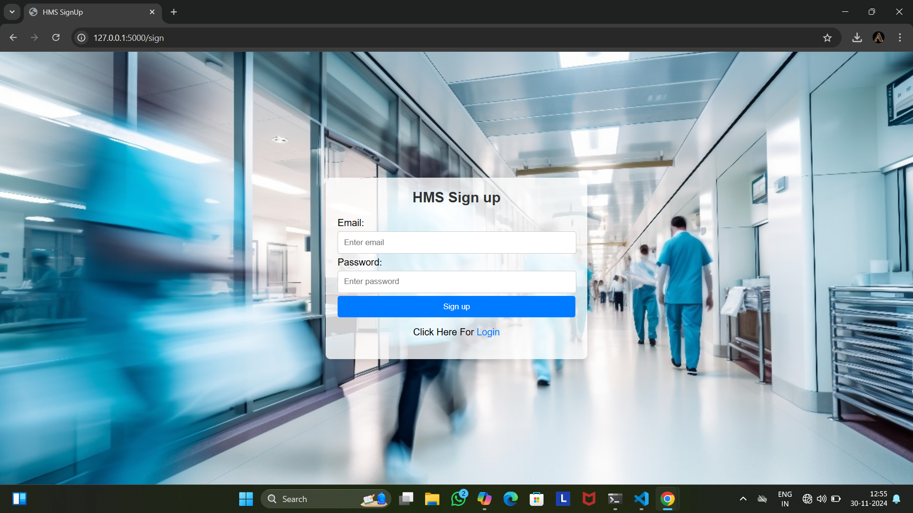
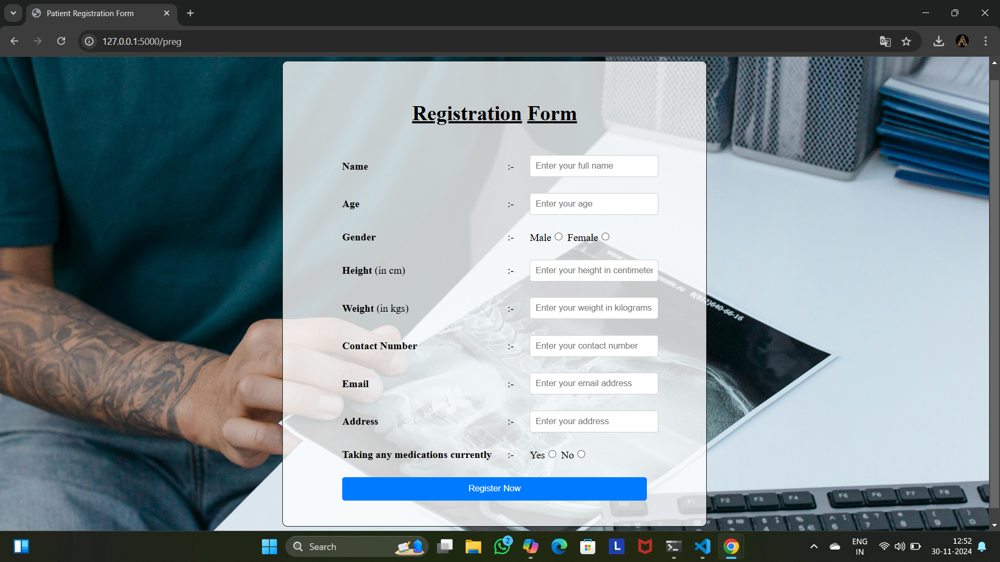
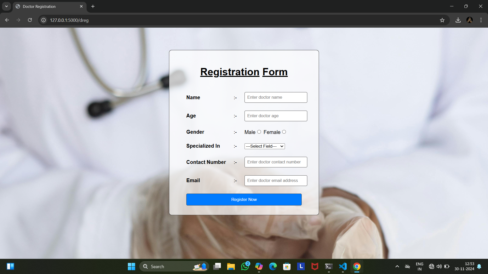
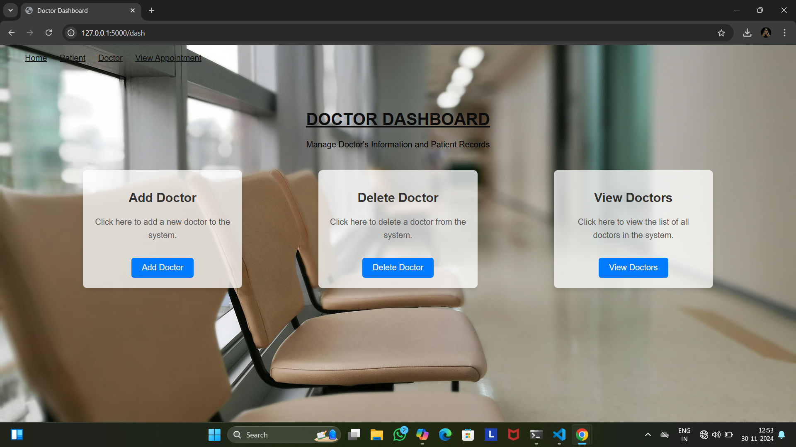
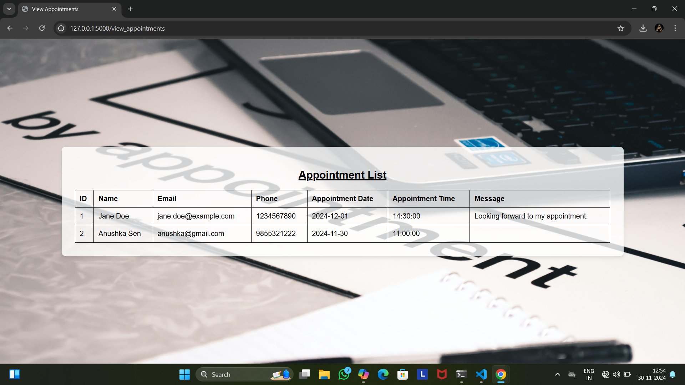
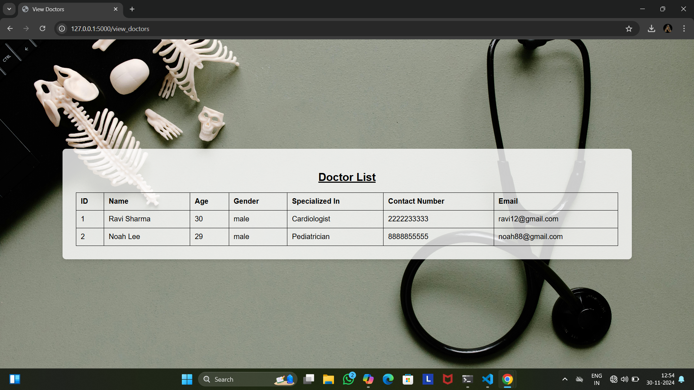
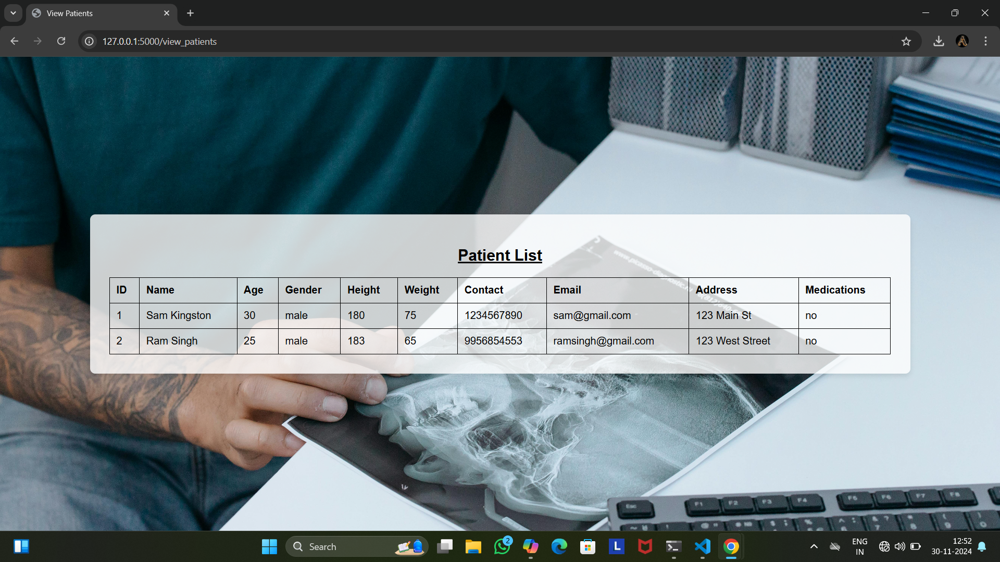
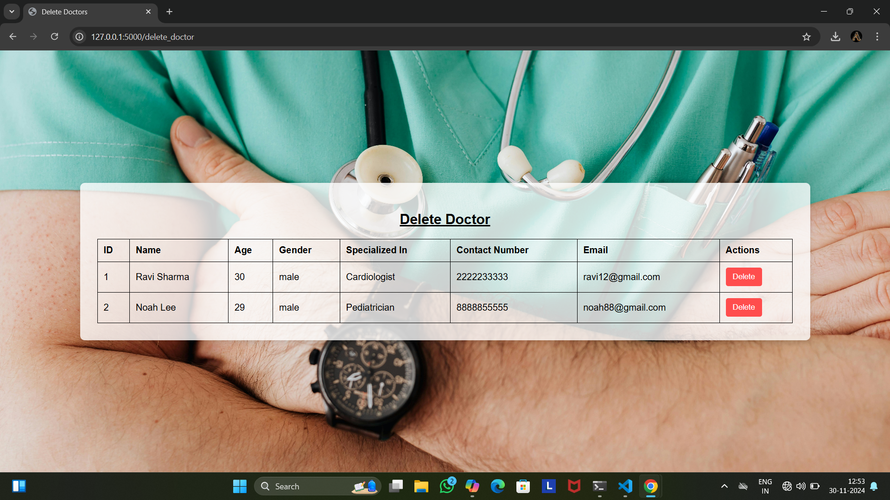
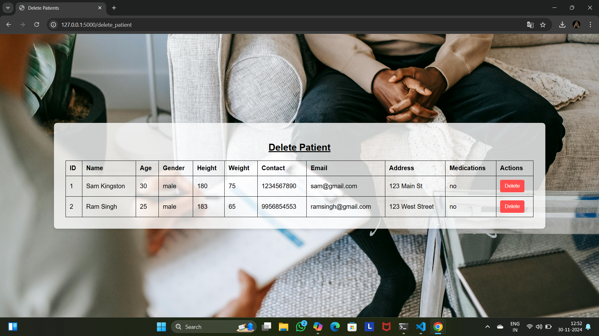

# 🏥 Hospital Management System (HMS)

A web-based Hospital Management System that digitizes patient registration, doctor management and appointment booking, so patients can skip long hospital queues and administrators can manage everything from one place.

Built as a Bachelor of Computer Applications (BCA) final project at Jagran College of Arts, Science & Commerce (Academic Year 2022–25).

---

## 📌 Table of Contents

- [Problem Statement](#-problem-statement)
- [Features](#-features)
- [Tech Stack](#-tech-stack)
- [System Modules](#-system-modules)
- [Database Design](#-database-design)
- [Project Structure](#-project-structure)
- [Installation & Setup](#-installation--setup)
- [Usage](#-usage)
- [Screenshots](#-screenshots)
- [Advantages & Limitations](#-advantages--limitations)
- [Future Enhancements](#-future-enhancements)
- [Author](#-author)
- [Acknowledgement](#-acknowledgement)

---

## ❗ Problem Statement

Hospital queues are usually managed manually: patients travel long distances, take a token, wait for their turn, and only then find out the doctor is on leave or not taking appointments.

HMS solves this by letting patients:

- Book appointments from home
- Check whether a doctor is available
- Get an advance confirmation or decline from the doctor
- Pay the consultation fee online

This saves time and money for patients and helps hospitals work more efficiently.

---

## ✨ Features

### 👨‍💼 Admin
- Secure login with username and password
- Add, view, update and delete doctors
- View and manage patient records
- View all appointments
- Monitor transactions and generate confirmations
- Preview monthly / yearly data

### 🧑‍⚕️ Doctor
- Sign up / log in
- Confirm or cancel appointment requests
- View patient treatment records and details
- Add prescriptions for patients

### 🧑 Patient
- Sign up / log in and register with a unique patient ID
- Search doctor availability
- Book and cancel appointments
- View prescriptions and past appointments
- Pay the doctor's fee online and track previous transactions
- Instant bill generation

### 🔒 General
- Role-based access control
- Authentication required to access the application
- Fast data storage and retrieval with MySQL

---

## 🛠 Tech Stack

| Layer      | Technology        |
|------------|-------------------|
| Frontend   | HTML5, CSS3       |
| Backend    | Python, Flask     |
| Database   | MySQL             |
| OS Tested  | Windows 11        |

---

## 🧩 System Modules

1. **User & Login Module**: sign up, login and authentication
2. **Patient Management Module**: patient registration, appointments, prescriptions, payments
3. **Doctor Module**: doctor registration, specialization, appointment approval
4. **Admin Module**: manage doctors, patients, appointments and transactions
5. **Hospital Database**: central MySQL database shared by all modules

---

## 🗄 Database Design

The system uses a MySQL database with the following main tables:

- **User details**: login credentials and roles
- **Doctor details**: name, specialization, experience, contact, address
- **Patient details**: name, blood group, contact, address
- **Appointment details**: patient, doctor, date and status


## 📁 Project Structure

```
Hospital-Management-System/
│
├── app.py                 # Flask application entry point
├── templates/             # HTML templates
│   ├── index.html
│   ├── login.html
│   ├── signup.html
│   ├── patient_dashboard.html
│   ├── doctor_dashboard.html
│   └── ...
├── static/                # CSS, images
│   └── style1.css
├── screenshots/           # Project screenshots
├── requirements.txt
└── README.md
```

---

## ⚙️ Installation & Setup

### Prerequisites

- Python 3.8+
- MySQL Server
- pip

### Steps

1. **Clone the repository**
   ```bash
   git clone https://github.com/<your-username>/Hospital-Management-System.git
   cd Hospital-Management-System
   ```

2. **Create a virtual environment (recommended)**
   ```bash
   python -m venv venv
   venv\Scripts\activate        # Windows
   source venv/bin/activate     # macOS / Linux
   ```

3. **Install dependencies**
   ```bash
   pip install flask mysql-connector-python
   ```
   (or `pip install -r requirements.txt` if you add one)

4. **Set up the database**
   ```sql
   CREATE DATABASE hms;
   ```
   Then import the schema:
   ```bash
   mysql -u root -p hms < database/hms.sql
   ```

5. **Configure database credentials** in `app.py`:
   ```python
   host = "localhost"
   user = "root"
   password = "your_password"
   database = "hms"
   ```

6. **Run the application**
   ```bash
   python app.py
   ```

7. Open your browser at **http://127.0.0.1:5000**

---

## ▶️ Usage

1. Open the home page and choose **Admin**, **Doctor** or **Patient**.
2. New users can **Sign up**; existing users can **Log in**.
3. **Admin** adds doctors and manages records.
4. **Patients** register, search for a doctor, and book an appointment.
5. **Doctors** confirm or decline appointments and add prescriptions.

---

## 📸 Screenshots

### Home Page


### Sign Up


### Patient Registration


### Doctor Registration


### Doctor Dashboard


### View Appointments


### View Doctors


### View Patients


### Delete Doctor


### Delete Patient

---

## ✅ Advantages & Limitations

**Advantages**
- Automates manual hospital procedures
- Doctors can easily view patient treatment records
- Instant bill generation
- Saves time, effort, money and resources
- Convenient and flexible to use

**Limitations**
- Requires a large database over time
- Admin must keep information up to date
- Needs an internet connection

---

## 🚀 Future Enhancements

- Automated email / SMS appointment reminders
- Stock shortage alerts for hospital inventory
- Online payment gateway integration
- Daily auditing and revenue statistics dashboard
- Password hashing and stronger security features

---

## 👩‍💻 Author

**Ankita Prajapati**
BCA, Jagran College of Arts, Science & Commerce

**Guided by:** Mr. Vikash Dwivedi (Project In-Charge)
**Industry Expert / H.O.D:** Mr. Nikhil Shukla

---

## 🙏 Acknowledgement

Sincere thanks to Mr. Vikash Dwivedi and the faculty of Jagran College of Arts, Science & Commerce for their guidance and support throughout this project.

---

## 📄 License

This project was developed for educational purposes. 
